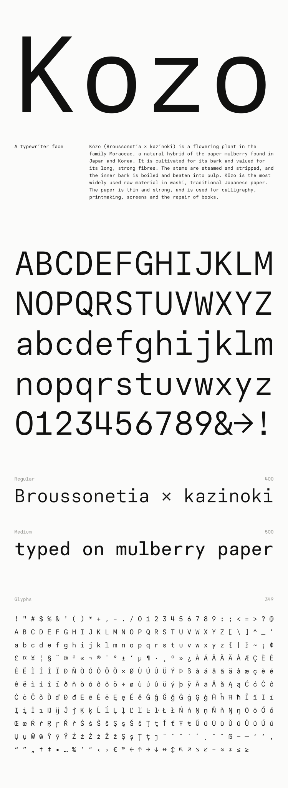

# Kozo



A typewriter face for the web, made for [keatonelvins.com](https://keatonelvins.com). Kōzo (楮) is the Japanese paper mulberry.

```css
@font-face { font-family: Kozo; src: url(Kozo-Regular.woff2); font-weight: 400; }
@font-face { font-family: Kozo; src: url(Kozo-Medium.woff2); font-weight: 500; }
body { font: 15px/20px Kozo, monospace; }
```

Built in code from [Paper Mono](https://github.com/paper-design/paper-mono): `uv run kozo` rewrites [`fonts/`](fonts).

[OFL 1.1](OFL.txt).
